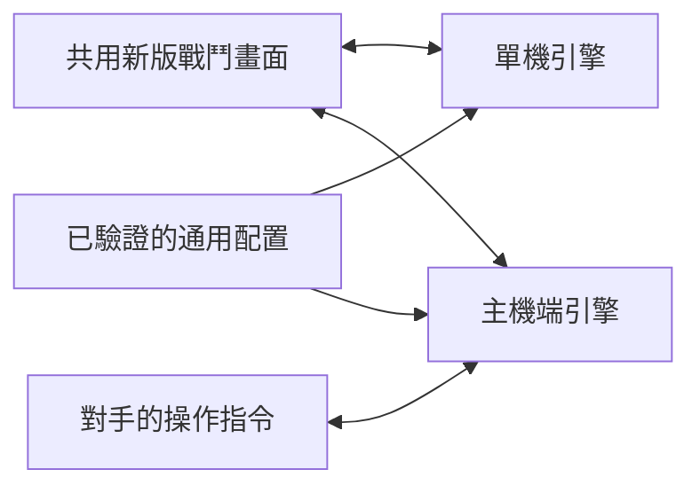

# 新版設定、通用存檔與雙人連線規劃

## 新版設定介面

保留目前控制中心的開啟方式。第一層改用 Aegis 風格的圖示卡片，每張卡片有簡短文字與目前值，例如「操作　全螢幕 F8」。點進後開啟該類的詳細頁。從戰場進入時可直接開啟「對戰」或「操作」，關閉後回到當前戰場。首頁先載入卡片與摘要，編輯器和詳細頁按需載入。

| 入口 | 詳細頁內容 |
| --- | --- |
| 顯示 | 主題、背景、畫質、字體與動態效果 |
| 音訊 | 音量、靜音、各頁音樂與跨頁播放 |
| 操作 | 全螢幕、目前快捷鍵、改鍵與恢復預設 |
| 對戰 | 計時器、動畫、戰報、自動空過與 AI |
| 存檔 | 管理配置、匯入預覽、匯出、備份還原 |
| 系統 | 更新、效能診斷與桌面選項 |

圖示配可讀標籤，鍵盤可逐項定位。分類和詳細頁共用設定鍵，每項偏好只有一個寫入入口。需要重載的項目明示生效時點，會替換配置或還原資料的操作提供預覽。

## 可攜式存檔

目前瀏覽器以本機儲存保存資料，桌面透過 `playerSaveBridge` 同步磁碟副本。磁碟端已有修訂號、寫入鎖與歷史備份。可攜式存檔建立在這層之上，匯出經驗證的配置內容，避免讓匯入檔直接指定任意儲存鍵。

- 第一版支援隊伍、首發、出戰與待命排序、技能槽、裝備、特性、特質、自訂精靈及所需素材。官方內容以穩定資料編號引用，自訂內容以固定 ID 和可驗證的定義攜帶。
- 區分「分享配置」與「個人備份」。分享配置只含套用該隊所需的資料。個人備份才包含多套配置與玩家主動勾選的偏好。API 金鑰、登入資料、快取、執行中戰局與連線權杖都排除。
- 分開記錄存檔格式版本、資料目錄版本與對戰規則版本。格式用來決定如何遷移，資料目錄用來解析精靈與技能，連線規則版本用來決定能否同房對戰。程式的發行版本另外記錄供診斷。
- 匯入依序做格式驗證、遷移、比對缺項與預覽。預設存成一套新配置，可以立即載入編成。使用者確認覆蓋時，先建復原點，再提交整套配置。舊版遷移需可重複執行，寫入失敗時保留原配置。
- 自訂積木以既有驗證器檢查可用操作、欄位與範圍。缺圖可選擇使用替代圖。缺關鍵技能或效果時，預覽標示受影響的配置，待解決再放行出戰。

| 匯入情況 | 處理方式 |
| --- | --- |
| 舊格式有遷移路徑 | 複製後升級，展示變更與缺項，原始檔保留 |
| 同格式但隊伍、技能或資料 ID 衝突 | 預覽並提供另存、對應或手動替換 |
| 檔案格式比本機新 | 顯示所需版本並保留原檔。若有已定義的相容子集，才允許預覽該部分 |
| 資料損壞或無法安全遷移 | 停在預覽／檢查階段，現有配置仍可使用 |

## 單機與雙人連線

第一階段接上兩人私房的信令與房間 UI。新版大廳可建房、用邀請碼加入、複製房間碼並交換出戰精靈與就緒狀態。信令只交換建立資料通道所需的 SDP，WebRTC 資料通道承載房間訊息。公開連線預設採 TURN，客戶端將 ICE 策略限制為中繼。直連需由服務開啟，雙方各自確認。 [W3C WebRTC 規格](https://www.w3.org/TR/webrtc/)

### 後端部署參數

獨立信令可用 `npm run p2p:signal` 啟動，預設監聽 `127.0.0.1:3091`。在公開網站後面設定 HTTPS 反向代理，轉送 `/api/p2p`。若由既有 Node 伺服器共用來源，可用 `SEER_P2P_ENABLED=1` 掛載。跨來源部署用 `SEER_P2P_ORIGINS` 指定允許的完整來源，以逗號分隔。H5 編譯可用 `VITE_SEER_P2P_ORIGIN` 設定房間預設信令位址，房間表單也可改填。

| 變數 | 用途 |
| --- | --- |
| `SEER_P2P_TURN_URLS` | 逗號分隔的 TURN／TURNS 位址 |
| `SEER_P2P_TURN_SECRET` | TURN 服務與信令服務共用的 REST 金鑰，只設定於後端 |
| `SEER_P2P_ALLOW_DIRECT` | 設為 `1` 開放直連實驗，玩家仍須同意 |
| `SEER_P2P_STUN_URLS` | 直連實驗可選用的 STUN 位址 |
| `SEER_P2P_PORT`、`SEER_P2P_HOST` | 獨立信令服務的監聽連接埠與位址 |

後端根據房間期限簽發短效 TURN 憑證。房間碼供加入，兩個席位各有獨立權杖用於交換信令與離房。房間存在記憶體，設有期限、房間上限、請求頻率和內容大小限制。第一階段部署使用單一信令程序，多程序部署前須共用有期限的房間狀態。房主或加入者主動離房時銷毀房間。 [coturn TURN REST 憑證說明](https://github.com/coturn/coturn/blob/master/README.turnserver)

### 對局接線流程

- 私房由房主端執行對戰引擎。對手送出帶回合與序號的操作，房主端驗證合法行動後傳回允許公開的結算資料。P2P 減少集中結算負擔，房主仍掌控結果。若日後加入排名或獎勵，該模式使用獨立權威結算。
- 房間載入隊伍配置的副本，雙方就緒後鎖定該場配置。重連、戰局與戰報使用獨立資料。線上配置可經玩家主動匯出，再匯入單機編成。
- 目前引擎有種子和部分回合快照入口，也有模組層級的偽隨機計數及本機偏好讀取。接線前須把這些依賴隔離到每場對局。現有快照不足以當成完整跨版本續戰檔。
- 下一階段從固定規則的原廠精靈單挑開始，接上指令去重、逾時、結算投影及死亡換人。之後才開放重連、自訂內容和更多模式。兩端在加入時比對規則版本，配置檔版本獨立判斷。

## 推進順序與驗收

| 階段 | 完成條件 |
| --- | --- |
| 1. 存檔契約 | 單機匯出後在乾淨環境匯入並開戰。舊檔、未來檔、缺資料、毀損與寫入中斷都經實測 |
| 2. 設定入口與詳細頁 | 舊設定正確顯示，使用既有資料鍵。戰場開關設定後返回原本戰鬥視圖 |
| 3. 雙人私房 | 兩台客戶端跑完一場，覆蓋同時選招、逾時與陣亡換人。單機原始配置不變 |
| 4. 重連與擴充 | 重送指令、斷線重連、視角遮蔽、兩房並跑與規則版本不相容均有驗收，再開放更多規則與自訂配置 |

## 2026-11-26 獨立連線版本與測試更新

新增獨立入口 `online.html` 和 `src/online/main.tsx`。使用 `npm run build:online` 產生 `dist-online`，`npm run online:start` 啟動信令及連線網頁，預設位址為 `http://127.0.0.1:3091`。該入口直接載入房間及共用素材，不執行單機的存檔還原、修補或同步流程。部署使用獨立子網域，讓瀏覽器設定儲存也各自隔離。配置的交換日後透過通用存檔完成。

範例環境設定位於 `server/p2p.env.example`。建置會把服務相依套件一併打包。將整份 dist-online 放到自己的主機，使用 Node 22 以上進入該目錄執行 npm start 即可，專案既有的靜態網站發布流程無法承載常駐信令程序。公開部署時讓 HTTPS 反向代理對應到連線服務，將 `SEER_P2P_PUBLIC_ORIGIN` 設為完整公開來源。分開部署前端時再設定 `SEER_P2P_ORIGINS` 白名單及前端的 `VITE_SEER_P2P_ORIGIN`。TURN 另須可到達的 UDP/TCP/TLS 位址，金鑰僅放後端。現有工作區未提供公開信令與 TURN 服務憑證，外網驗收待部署資料到位。

建置資料夾內附 .env.example，可複製為 .env 後填寫主機的實際設定。公開連線仍需有效 HTTPS 網址與 TURN。

### 已執行的驗證

- `npm run test:p2p` 啟動真實 HTTP 服務，21 項檢查涵蓋版本不符、席位權杖、拒絕第三人、TURN 憑證簽發、中繼候選限制、過大與畸形請求、來源限制、限流與銷毀房間。
- `npm run test:p2p-browser` 啟動隔離的真實 Edge 雙頁，經正式信令建立 WebRTC，完成版本握手、雙向就緒訊息、延後送出、心跳延遲回報、主動離房、重新建房與畸形訊息斷線。本次本機 RTT 觀察約 1–37 毫秒，實際資料通道走本機直連。此數值只能代表本機測試。
- 獨立建置服務的首頁、靜態素材與建房皆通過實測，單機存檔和 AI 端點在此服務回傳 404。真實瀏覽器也驗證載入獨立版本及建房期間，既有隊伍存檔原文保留。
- 網際網路 TURN 中繼、不同電腦與不同路由器、網路實際丟包、長時間連線及完整對局尚待驗證。測試頁面使用專用瀏覽器資料夾，結束時回收測試程序。

### 對戰連線效能設計

回合制以事件驅動傳送操作和結算。房主端的戰鬥引擎放在專用 Worker，其他玩家只送當輪操作。UI 和雙方的動畫時間軸各自消費已確認的結算事件。選招計時依房主的操作截止時間與階段序號顯示，網路心跳時間與演出進度各自記錄。先量測正式引擎，再決定是否需要縮小每輪 Worker 的工作批次。

1. 每場只有一個權威引擎、種子與機率計數。Worker 隔離現有模組層級的 PRD／PRNG。玩家輸入通過合法動作驗證後才進入引擎，未收到對方操作時仍可操作本機設定、檢視效果與預載素材。
2. 操作攜帶 session、turn、phase、sequence 和精靈 battleId。房主重複收到同一序號只回傳確認。舊回合與錯誤身分的操作拒絕，防止重送變成連續出手。雙方操作就緒後才推進正式結算，畫面顯示等待哪一側。
3. 首次傳送精簡且依觀看側過濾的快照，後續只傳事件與必要差異。以序號檢查缺漏，必要時請求新快照。完整技能資料、圖片、動態圖集從各自版本化的本機／HTTP 素材庫載入。
4. 動畫有獨立佇列與長度上限。慢機可降低畫質、略過重複演出並追到最新已確認狀態。演出出錯要能放行後續動畫，判勝與傷害結果依權威狀態。
5. 傳送前檢查 DataChannel 的 bufferedAmount，大狀態分塊且分批傳送，等 bufferedamountlow 再繼續。控制訊息有固定容量上限。最新狀態可合併，關鍵操作及結算事件要保持順序並確認收到。 [W3C DataChannel 規格](https://www.w3.org/TR/webrtc/)
6. 心跳顯示往返延遲，逾時結束房間等待並提示重連。下一階段再加入席位恢復權杖、快照續接及雙方一致的對局暫停時點。目前離房和嚴重通道錯誤採重新建房。
7. 房主同時擁有執行引擎與修改結果的能力。朋友私房可採用這個信任模型，未來需要可靠排名時另接伺服器結算。
8. 目前 TURN 憑證跟房間使用 30 分鐘期限，房間程式只支援連線測試。正式長對局須增加憑證續發、重新協商和更長時間的存活驗收，避免對戰中途失去中繼。

### 下一階段對局的驗收門檻

以同一份固定回合序列建立離線參考結果，再從網路操作重播，比對雙方最終體力、PP、印記、計數器、勝負與事件序號。加入重送、延遲送出、亂序、斷線、慢動畫及暫停恢復測試。再以不同網路下的 TURN 連線量測 P50/P95 RTT、單輪結算耗時、主執行緒長任務、動畫追趕時間、每輪位元組與發送佇列峰值。先建立實測基準再訂效能預算。
